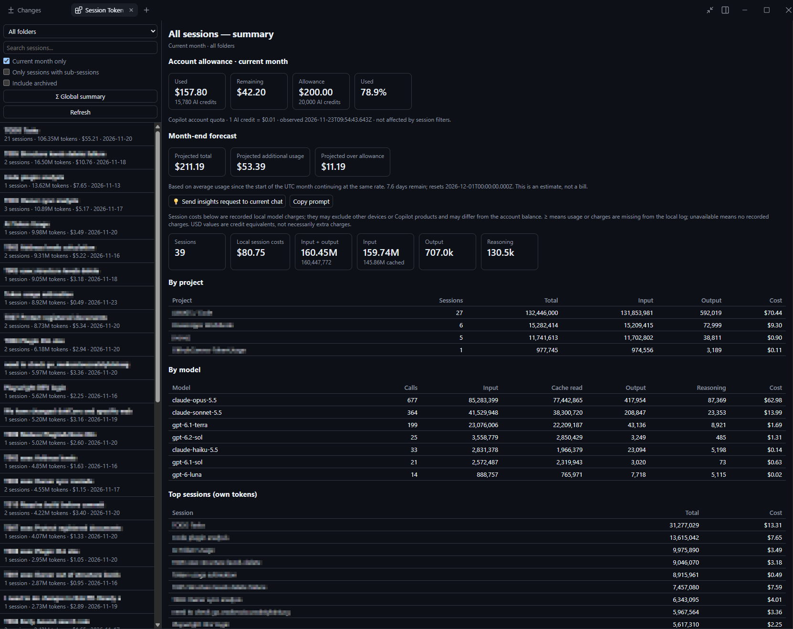

# Session Token Usage canvas

A GitHub Copilot canvas showing local session and sub-session token usage, model costs, account allowance, and a month-end credit forecast.

## Screenshot

## Install

Requires the GitHub Copilot app with canvas extension support and Python 3 available as `python` or `py` on PATH. You need access to this private repository.

In the Copilot app, ask the assistant to install the canvas extension from:

`https://github.com/JustasGOERP/GithubCanvas-TokenUsage/tree/main/session-token-usage`

Choose a user installation to make it available across projects. Alternatively, copy the `session-token-usage` folder to `~/.copilot/extensions/` and reload extensions or restart the app.

## Use

Ask the assistant to open **Session Token Usage**. Select a session to see its usage and descendants, or choose **Global summary** for totals, allowance, and the forecast. Filter by folder, month, or archived status and use Refresh to update the data.

The extension reads local Copilot databases read-only and serves the panel on localhost. The optional **Send insights request** button sends a usage summary, including session and project names, to the current chat; **Copy prompt** copies it instead. Account quota is retrieved through Copilot. Local cost totals can be incomplete, and the forecast is an estimate, not a bill.

## Test

Run `node session-token-usage/test.mjs` to check the billing and forecast calculations.
